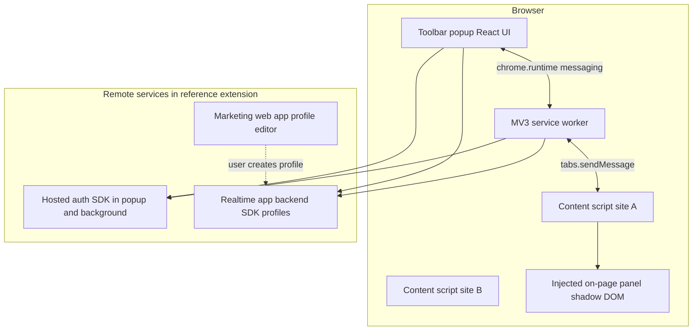

# Directory-launch extension UI patterns (spike notes)

Neutral observations from unpacking a **Manifest V3** Chrome extension (store version **1.4.6**, ~3.4 MiB) that automates **human-in-the-loop** directory submissions. These notes inform OpenQuok **auto-launch v1** (popup, per-site content scripts, optional step rail). **No third-party source code** is copied into this repository; spike artifacts stay outside git (local unpack only).

---

## Scope and methodology

| Item | Detail |
| --- | --- |
| Artifact | CRX v3 unpacked to a local scratch directory (ZIP payload after CRX header) |
| Build toolchain | Plasmo-style MV3 layout: hashed bundles, `popup.html` mounting a single React root, Parcel-style module graph in bundles |
| What we inspected | `manifest.json`, popup entry, background service worker, one **multi-step** directory bundle, manifest `content_scripts` list |
| What we did not ship | Minified JS, selectors, DOM queries, or proprietary filler implementations |

Use this document to shape `auto_launch_destinations.extension_config`, extension messaging in `common/src/browser-extension/`, and OpenQuok’s popup + on-page panel—not to mirror another product’s codebase.

---

## Layered architecture

**OpenQuok v1 mapping (contrast):**

| Reference pattern | OpenQuok v1 |
| --- | --- |
| Third-party auth + BaaS profile sync | OpenQuok session cookies on `openquok.com`; `GET/POST /api/v1/auto-launch/*` org-scoped |
| Web app as profile source of truth | Dashboard **My Products** + `submissions/intent` returns `profile_snapshot` + `extension_config` |
| No `externally_connectable` in reference manifest | Dashboard handoff via existing `externally_connectable` + `extensionClient` (Skool path) |

---

## Toolbar popup

### Structure

- `action.default_popup` → minimal HTML shell + one client bundle (React).
- Primary jobs: **sign-in gate**, **SaaS profile picker**, **contextual status** for the active tab, **launch / autofill actions**, footer **disclaimer**.

### Auth and empty states (observed copy themes)

| State | User-facing intent |
| --- | --- |
| Signed out | Prompt to sign in to manage directory submissions and load saved profiles |
| Signed in, no profiles | “Create your first … profile to get started” (links user to web app) |
| Signed in, profiles loaded | Searchable list; “Untitled Profile” fallback label |

### Profile selection

- Dropdown or list bound to remote profile documents (name, tagline, website).
- Selection drives all fill operations on the active tab.

### Status line (contextual)

The popup and/or on-page UI reflect **page URL and directory adapter**, not a single static string. Examples of **status categories** extracted from the multi-step directory bundle:

| Situation | Example status text (paraphrased themes) |
| --- | --- |
| Wrong page | “Not on a … submission page” / “Not on a supported page” |
| Pre-submit URL step | “Step 1: Paste your product URL”, “Ready to autofill product URL” |
| Awaiting user navigation | “Navigate to ‘Submit’ to start auto-filling” |
| In progress | “Filling…”, “Step *k*/*n*: Filling …”, “Ready to fill: …” |
| Success (partial or full) | “Fields filled successfully”, “All fields filled! Please review before submitting” |
| Failure | “Autofill failed - check console”, “No fields could be filled”, “Some fields could not be filled - check field statuses” |

### Primary actions

| Control | Behavior |
| --- | --- |
| **Fill / autofill all steps** | Sequentially runs step fillers on the submission flow; may **click “Next”** between wizard steps (still no final Publish/Submit automation emphasized in disclaimer) |
| Per-step **Fill** | Available in the on-page rail (see below); popup may mirror “click to autofill each step” |
| **Reset panel position** | UX affordance to re-anchor the floating panel (reference uses expandable overlay chrome) |
| Login CTA | “Go to Login” when session missing |

### Disclaimer (footer)

- Privacy-oriented line: actions run **locally in the browser**; user reviews and submits on the directory site (ToS / human-in-the-loop positioning).

**OpenQuok:** Reuse tone from `BrowserExtensionConnectDialog` / channel connect legal pattern where applicable; keep disclaimer in popup footer.

---

## Background service worker

- Single large bundle: auth client, profile/API client, and UI kit remnants (same stack as popup).
- Responsibilities inferred from MV3 layout and cross-bundle strings:
  - Message hub between popup and content scripts
  - Profile fetch / cache coordination
  - Optional analytics or logging hooks (failed message / connection loss handling)
- **Permissions:** `storage`, `cookies`; **host_permissions** per directory origin plus auth/API hosts.

**OpenQuok:** Extend `extension/background.js` with `AUTO_LAUNCH_*` routes; complete submissions via cookie-authenticated `POST …/submissions/complete` (extension-only).

---

## Per-site content script bundles

MV3 requires **static** `content_scripts` entries—no dynamic registration. The reference extension ships **one JS bundle per directory**, registered only on that site’s URL patterns.

### Manifest pattern

| Field | Typical use |
| --- | --- |
| `matches` | Mix of site root, `/submit`, `/posts/new`, or form-specific paths |
| `js` | Single hashed bundle per provider |
| `run_at` | `document_idle` |

### Seeded destinations in v1.4.6 spike (18 bundles)

Count and **host patterns** matter for OpenQuok’s `directoryLaunchProviders` registry (`hostPatterns`, `contentScriptEntry`). Observed registrations:

| Bundle key (filename stem) | URL focus (summary) |
| --- | --- |
| `producthunt` | `producthunt.com` including `/posts/new` |
| `betalist` | `betalist.com/submissions/…` |
| `devto` | `dev.to` |
| `alternativeto` | `alternativeto.net/manage-item/…` |
| `launchingnext` | `launchingnext.com/submit/…` |
| `sideprojectors` | `…/submit/project/…` |
| `tinylaunch`, `firsto`, `launchigniter`, `peerpush`, `huzzler`, `promoteproject`, `startupslab`, `saashub`, `crunchbase`, `brownbook`, `sitelike` | Marketing or submit paths on each matching host |
| `microlaunch` | Specific third-party form URL (`tally.so/…`) |

Simpler sites: one-shot form fill inside the bundle, often **without** a step rail. Complex sites: dedicated adapter + injected UI.

**OpenQuok v1:** Start with **2–3** destinations (e.g. Uneed-first); add manifest entries per `provider_slug`; keep filler logic in `extension/content/directory-launch/{slug}.js` keyed to `extension_config`.

---

## Multi-step flow: Product Hunt–style step rail

The richest UX in the spike is a **left (or overlay) “Submission steps” rail** on the multi-step directory wizard (`/posts/new/submission` path theme). OpenQuok should drive equivalent UI from `auto_launch_destinations.extension_config.steps[]` (labels, field keys, selector hints)—not hard-coded competitor strings in source.

### Step catalog (IDs and labels)

| Step `id` | Label shown in rail |
| --- | --- |
| `main-info` | Main Info |
| `images-and-media` | Images & Media |
| `makers` | Makers |
| `shoutouts` | Shoutouts |
| `extras` | Extras |
| `launch-checklist` | Launch Checklist |

Rail section title: **Submission Steps**.

### Step card UX

Each step row includes:

| Element | Purpose |
| --- | --- |
| Step icon | Completed vs current vs pending |
| Label | From table above |
| Progress | `filledCount / totalFields` style bar when current |
| **Fill** button | Runs one step’s filler module |
| Field checklist | Per-field row: label, filled / empty / error icon |

### Field-level status vocabulary

| Status | Meaning |
| --- | --- |
| Filled | DOM target found and value applied |
| **Field not found** | Selector missed (site DOM drift) |
| **Not in profile** | Profile snapshot missing mapped value |
| Site-specific | e.g. “Fields not found - PH may have changed” (directory may have updated UI) |

Aggregated toasts: “*n* fields filled, *m* issue(s)”, “Failed to fill *step*”.

### Automation sequence (“fill all”)

Observed orchestration (behavioral summary only):

1. Detect **active wizard step** (data attributes on step container, e.g. `data-test` / `data-status`).
2. Map step id → filler module (`mainInfo`, `images`, `makers`, `shoutouts`, `extras`, `launchChecklist`).
3. Run filler; update field statuses.
4. If configured, **click Next** and wait until the next step becomes active; repeat until last step or error.
5. **Does not** auto-click final directory **Publish/Submit** (aligned with disclaimer).

Pre-wizard **URL paste** step is separate: copy themes include product URL field, “URL filled - click Continue”, login checks for the directory account.

### Representative field labels (for `extension_config` seeding)

These are **directory form labels** the reference maps to profile paths—not OpenQuok UI copy:

- Main Info: product name, tagline, description, pricing type, category/tags, website/product URL
- Images & Media: logo, gallery/screenshots, banner; handles upload inputs and clearing existing media
- Makers: maker usernames tied to directory accounts
- Shoutouts: shoutout entries
- Extras: first comment, “why did you build this”, launch tags, video/loom link
- Launch Checklist: checklist-specific controls

Use these as hints when authoring `profilePath` and `selectorHint` in seeds; validate against live DOM during implementation.

---

## Adapter abstraction (conceptual)

The multi-step bundle implements a **directory adapter** pattern:

| Concept | Role |
| --- | --- |
| `detectCurrentStep()` | Returns active step id or null |
| `getStatusMessage(step, context)` | Popup/rail status strings |
| Step fillers | Async functions: `{ profile, setFieldStatuses }` → per-field results |
| Shared DOM helpers | Label-based setters, image upload helpers, URL input helper |

OpenQuok equivalent: `fillStep(stepId, profileSnapshot)` per `provider_slug` module; config defines steps/fields; progress events via `AUTO_LAUNCH_PROGRESS`.

---

## Error handling and DOM drift

| Scenario | UX |
| --- | --- |
| Selector miss | Field row error; console diagnostics with tagged log prefix |
| Step not implemented | “Step not implemented yet” / “Step not supported” |
| Wizard navigation failure | Messages when Next click fails or next step never activates |
| Partial fill | User asked to review before submit; aggregate issue count |

Recommend **`extension_config.version`** in OpenQuok seeds and hub copy that directories change frequently.

---

## Mapping checklist → OpenQuok implementation

| Spike pattern | OpenQuok artifact |
| --- | --- |
| Popup profile picker + status | `extension/popup/` + cached API profiles |
| Per-site bundle | `manifest.json` `content_scripts` + `directory-launch/{slug}.js` |
| Step rail + per-step Fill | Content script panel; `extension_config.steps` from API via `intent` |
| Fill all | `AUTO_LAUNCH_FILL_ALL` message; sequential `fillStep` |
| Dashboard handoff | `web/src/lib/auto-launch/browser-extension/` + `AUTO_LAUNCH_HANDOFF` |
| Human submit | No auto-submit; `submissions/complete` with evidence URL only after user confirms |

---

## Related docs

- Auto-launch architecture (protocol, tables, modal flow): `docs/auto-launch/architecture.md` (when added)
- Future launch showcase (entries, boost stub, SKU): `docs/auto-launch/launch-showcase.md`
- Internal implementation plan: auto-launch v1 modal + extension milestones in product planning (not duplicated here)

---

## Revision log

| Date | Notes |
| --- | --- |
| 2026-10-13 | Initial spike from CRX v1.4.6 unpack; PH-style step ids/labels and per-site manifest inventory |
