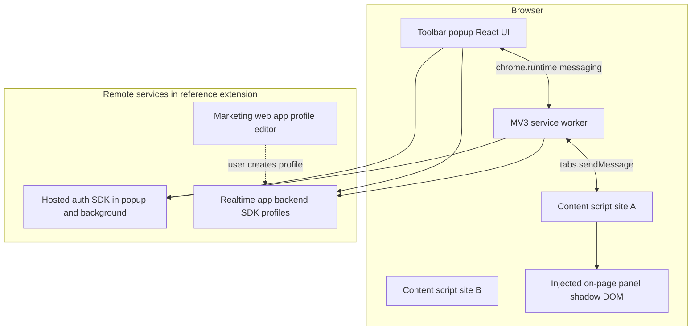
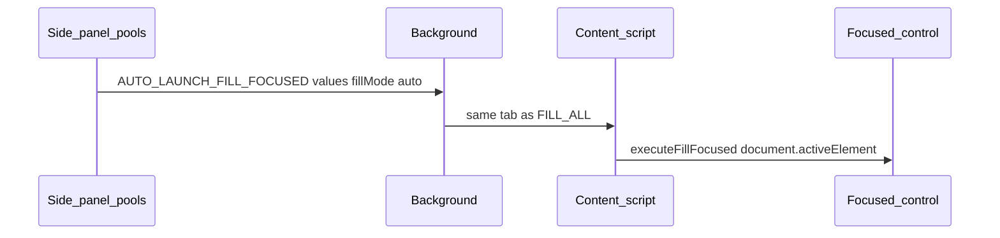
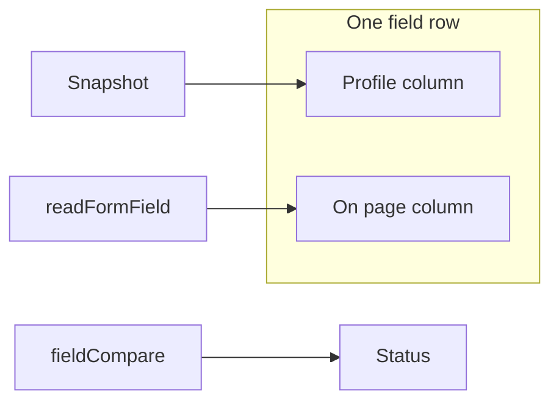

# Directory-launch extension UI patterns (spike notes)

Neutral observations from unpacking a **Manifest V3** Chrome extension (store version **1.4.6**, ~3.4 MiB) that automates **human-in-the-loop** directory submissions. These notes inform OpenQuok **auto-launch v1** (popup, per-site content scripts, optional step rail). **No third-party source code** is copied into this repository; spike artifacts stay outside git (local unpack only).

---

## Scope and methodology

| Item | Detail |
| --- | --- |
| Artifact | CRX v3 unpacked to a local scratch directory (ZIP payload after CRX header) |
| Build toolchain | Plasmo-style MV3 layout: hashed bundles, `popup.html` mounting a single React root, Parcel-style module graph in bundles |
| What we inspected | `manifest.json`, popup entry, background service worker, one **multi-step** directory bundle, manifest `content_scripts` list |
| What we did not ship | Minified JS, selectors, DOM queries, or proprietary filler implementations |

Use this document to shape `auto_launch_destinations.extension_config`, extension messaging in `common/src/browser-extension/`, and OpenQuok’s popup + on-page panel—not to mirror another product’s codebase.

---

## Layered architecture

**OpenQuok v1 mapping (contrast):**

| Reference pattern | OpenQuok v1 |
| --- | --- |
| Third-party auth + BaaS profile sync | OpenQuok session cookies on `openquok.com`; `GET/POST /api/v1/auto-launch/*` org-scoped |
| Web app as profile source of truth | Dashboard **My Products** + `submissions/intent` returns `profile_snapshot` + `extension_config` |
| No `externally_connectable` in reference manifest | Dashboard handoff via existing `externally_connectable` + `extensionClient` (Skool path) |
| Top **Login Required** banner(s) when product or directory session missing | Single shadow-DOM banner (`extension/src/directory-launch/loginBanner.ts`) via `directory-site-gate` content script; OpenQuok first, then directory site |
| Directory login heuristic (e.g. nav shows `/auth/login`) | Per-site adapters under `extension/src/directory-launch/siteLogin/`; re-check on load (~1s), `MutationObserver` while banner visible, tab visibility / `popstate` |

---

## Directory login notification banners

Reference MV3 extension (spike **1.4.6**) shows **two layered gates** on directory origins: a hosted **product account** banner when the SaaS session is missing, and a **directory site** banner when the user is signed into the product but not the directory (autofill stays gated until both pass).

### Reference vs OpenQuok (behavioral)

| Layer | Reference (observed) | OpenQuok |
| --- | --- | --- |
| Product / OpenQuok | Fixed top banner: **Login Required**, CTA **Go to Login** → hosted auth URL | `access_token` cookie on dashboard origin(s) via background (`OPENQUOK_CHECK_DIRECTORY_GATE`); CTA → `{origin}/sign-in` (remembered handoff origin, then defaults) |
| Directory site | Second banner when product OK but directory session missing; CTA → directory login URL | Same banner chrome; copy names the site (PeerPush, Uneed); CTA → adapter `loginUrl` |
| Layout / style | `position: fixed; top: 20px; left: 50%; transform: translateX(-50%);` ~90% width, max 600px; amber panel (`#fef3c7`, border `#f59e0b`) | Matched in `DirectoryLoginBanner`; `z-index` **2147483645** (step rail uses **2147483646** in `stepRail.ts`) |
| Single injection | One gate script per host union | `extension/src/content/directory-launch/directory-site-gate.ts` — not duplicated per `provider_slug` bundle |

Gate state is broadcast as `openquok-directory-gate-change` on `window`; directory launch providers disable **Fill** / **Fill all** and show inline copy from `directoryGate.ts` when either gate is closed.

### Site login adapters (DOM heuristics)

Adapters treat **presence of a nav “Log in” link** as signed **out** (inverse: link absent ⇒ logged in). Re-verify selectors when a directory changes its header or SPA shell.

| Site key | `loggedIn` heuristic | Login URL | Evidence |
| --- | --- | --- | --- |
| `peerpush` | No `a[href="/auth/login"]` in the document | `https://peerpush.com/auth/login` | Nav link on `peerpush.com/pricing` when signed out (reference spike used the same selector theme on a sibling host) |
| `uneed` | No `a[href="/login"]` in the document | `https://uneed.best/login` | Header **Log in** on `uneed.best/pricing` when signed out; nav may hydrate after first paint — gate re-checks after ~1s and on debounced DOM mutations |
| `open-launch` | No `a[href="/sign-in"]` and no submit auth gate (`input[type="password"]` + `a[href="/sign-up"]` or **Welcome back** + **Login with Google**) | `https://open-launch.com/sign-in` | Nav **Sign in** after SPA hydration on `open-launch.com/pricing`; `/projects/submit` shows full-page login when session is missing |

Unknown site keys default to **logged in** for the directory layer (avoid false “please log in” on future hosts until an adapter exists). Host patterns come from `getDirectoryLaunchUniqueHostPatterns()` / `getDirectoryLaunchSiteKeyFromLocation()` in `common/src/auto-launch/destination-configs/directoryLaunchRegistry.ts` (re-exported via `pageAssist.ts` and `destination-configs/index.ts`).

**Side panel:** `extension/src/ui/sidepanel/directoryTab.ts` calls the directory gate check and can surface an OpenQuok sign-in warning above disabled fill actions when the dashboard session is missing.

### Directory tab without dashboard Launch

From the side panel **Directory** tab, picking a **channel chip** (no active handoff yet) calls `OPENQUOK_AUTO_LAUNCH_SHOW_PANEL` with that `providerSlug`. The background worker:

1. Requires an OpenQuok session (extension API token) and at least one product profile.
2. Calls `POST /api/v1/auto-launch/submissions/intent` with `providerSlug` (default: first **main** profile in the workspace — same as `buildDirectoryLaunchHandoffFromSite`).
3. Reuses an open tab on that directory host, or **opens** the destination `startUrl`, then `persistHandoffForTab` + on-page step rail.

You do **not** need **My Products → Launch** first when signed in and a profile exists. Multi-product workspaces still start from the default main profile until the side panel adds a profile picker.

---

## Profile pools (side panel)

The **Directory** tab shows **profile pools** below the existing launch actions when a handoff session is active (`mountDirectoryProfilePools` in `extension/src/ui/sidepanel/directoryProfilePools.ts`). Pools mirror **My Products → Edit profile** composer sections so members can pick subset values and write them into whichever form control is focused on the directory tab — without replacing the on-page **step rail** (**Fill step** / **Fill all**).

Handoff stores a **profile snapshot** at intent time. After you edit the main profile in the dashboard, use **Refresh profile from OpenQuok** on the Directory tab (`OPENQUOK_AUTO_LAUNCH_REFRESH_PROFILE` → `POST /api/v1/auto-launch/submissions/intent/refresh`) so discovery pools (categories, use cases, etc.) match the live profile without clearing the session.

### Composer tab → pool sections

Sections and field definitions come from `common/src/auto-launch/profileFieldCatalog.ts` (`listProfilePoolSections`). Labels align with `ProductProfileComposer.svelte`:

| Pool section (`ProfilePoolSectionId`) | Composer tab | Typical fields |
| --- | --- | --- |
| `main` | General | `name`, `tagline`, `description`, `website_url`, `profile_data.pricing_type`, open source, slug, repository |
| `discovery` | Discovery | `categories`, `use_cases`, `target_audiences`, `platforms`, `tech_stack` |
| `media` | Media | `logo_url`, `profile_data.gallery_urls`, `profile_data.launch_video_url` |
| `socials` | Socials | `profile_data.social_*` |
| `sell` | Sell | Acquisition / MRR fields (section hidden when every field is empty) |

Array fields show **composer order**; helper text uses caps from `common/src/auto-launch/businessProfileData.ts` (e.g. categories, gallery count). The side panel does **not** hard-block selection beyond those hints in v1. Destination **`maxItems`** on a `LaunchStepField` (when set in `extension_config`) caps how many values the **on-page compare rail** shows from alternates and matches the directory form limit (e.g. Uneed Tags **3/3**).

**Discovery dimensions vs derived tags:** Members edit five typed lists in the dashboard composer (`categories`, `use_cases`, `target_audiences`, `platforms`, `tech_stack`). Generic keyword controls on a directory that map to `profile_data.tags` are **not** a composer field — at fill/readiness time `resolveProfilePathValue` returns stored `profile_data.tags` when non-empty (legacy rows), otherwise `deriveListingTags(profile_data)` in `common/src/auto-launch/businessProfileData.ts` (same dimension order, deduped, capped at `BUSINESS_PROFILE_MAX_TAGS`). Competitor / “similar product” values stay **per-directory** when the site offers that control; there is no global `profile_data.alternatives` in the composer.

**Launch highlight:** Fields whose `profilePath` appears in the active session’s `extension_config` get a **Launch** badge (`highlightPathsForDestination` / `collectProfilePathsFromExtensionConfig`). Sections that contain any highlighted field open expanded and show **For this launch** (e.g. Discovery on PeerPush, Uneed category/use-case dimensions plus derived tags on the Tags step, `tech_stack` on Open Launch).

### Focused fill workflow

1. **Navigate** to the ready submission page (`isReadyPage` + `pageMatchesConfig` — same gate as step **Fill**).
2. **Click** a directory form control (input, textarea, select, tag combobox, or rich-text / ProseMirror).
3. In the side panel: check items under **string_array** pools and/or use per-row **Fill focused** for scalars, booleans, and rich text.
4. **Fill selected into focused field** sends selected array values in catalog order across fields (checkbox map is per field id).
5. Content script `fillFocused.ts` resolves the focused element, infers `fillMode` when the message uses `auto` (`tags`, `rich_html`, `select`, `boolean`, else `text`), and reuses `fillEngine.ts` primitives. Focus inside the OpenQuok step-rail host (`#openquok-directory-launch-host`) is rejected.

**Bulk fill unchanged:** Step rail **Fill** / **Fill all** still map `extension_config.steps[]` by `selectorHint` (`AUTO_LAUNCH_FILL_STEP` / `AUTO_LAUNCH_FILL_ALL`).

### Profile vs on-page compare (step rail)

The on-page **Submission Steps** panel (`extension/src/directory/directory-launch/stepRail.ts`) shows a **two-column** table per wizard step: **Profile** (mapped `profilePath` from the intent snapshot) vs **On page** (live DOM read). Side-panel **profile pools** stay complementary for focused fill into whichever control is focused; the compare rail is the source of truth for “does this step match my OpenQuok profile before I submit?”

| Piece | Location |
| --- | --- |
| Step field schema | `LaunchStepField` in `common/src/browser-extension/pageAssist.ts` |
| Normalize + diff rules (no DOM) | `common/src/auto-launch/fieldCompare.ts` (`normalizeProfileValue`, `normalizeForCompare`, `compareFieldRow`) |
| DOM read | `extension/src/directory/directory-launch/readFormField.ts` (same `resolveFieldElement` export as `fillEngine.ts`) |
| Row state per session | `launchCompareState.ts` → `compareRowsByStep` in `registerProvider.ts` |
| Live refresh | `formFieldWatchers.ts` (`wireLaunchFormWatchers`) from `registerProvider.ts` — debounced `input`/`change` + `MutationObserver` on each field container (SPA hydration); staggered re-read on launch / panel reveal; `refreshCompareRowFromDom` at paint time |

#### Per-row UI

| UI | Behavior |
| --- | --- |
| Column headers | **Profile** \| **On page** (sticky within the widened panel, ~`min(92vw, 520px)`) |
| Left cell | Formatted value from **`profilePath` only** (tags as comma-separated chips in copy); empty → muted **Not in profile** (`.cell--profile-missing`) |
| Right cell | Value from `readFormFieldValue`; missing control → gray **Control not on page** (`.cell--missing-control`) |
| Match | Neutral/green tint (`.cell--match`) when normalized profile and form values agree |
| Diff | Amber (`.cell--diff`) when both sides have values but `normalizeForCompare` fails (trim, tag set equality, rich HTML strip, etc.) |
| Touched | Amber (`.cell--touched`) on the **right** column after a successful bind when the member edits the control and on-page value ≠ last fill baseline / expected profile |
| Required empty | Red tint (`.cell--required-empty`) when `required: true` and on-page value is empty |
| Expand chevron | Only when `profileSourcePaths` is non-empty (alternate discovery paths for the same directory control) |
| Expanded picker | Checkboxes for each alternate path; **Fill field** uses checked items (respecting `maxItems`) via `fillLaunchField` **`valuesOverride`** / **`valueOverride`** — does not mutate the snapshot |
| Step actions | **Fill** (step), **Fill all steps** (unchanged); per-row **Fill** beside **Profile** (profile → form); **Update** beside **On page** (writes the editable compare cell into the live control) |

Step header progress can show **X/Y in sync** when compare rows exist (alongside legacy fill-result icons from the last fill run).

#### `LaunchStepField` compare flags (fixtures)

These optional JSON fields on each `steps[].fields[]` entry are authored in `common/src/auto-launch/destination-configs/*.ts`, synced to `505_*_extension_configs.sql`, then stored on `auto_launch_destinations` and returned on the launch handoff as API `extension_config`:

| Field | Purpose |
| --- | --- |
| `required?: boolean` | Compare rail red empty state + authoring hint for mandatory directory controls (set in TS fixtures for known sites) |
| `maxItems?: number` | Display cap and alternate-path collection for tag/array fields on the directory form |
| `profileSourcePaths?: string[]` | Enables expand row: profile paths to offer as alternates when `profilePath` alone does not match how members think about the field (e.g. generic **Tags** ← discovery lists) |

**Uneed Tags (reference):** `profilePath: profile_data.tags`, `fillMode: tags`, `required: true`, `maxItems: 3`, `profileSourcePaths: ['profile_data.use_cases','profile_data.platforms','profile_data.tech_stack']` in `common/src/auto-launch/destination-configs/uneed.ts` (synced via `505_*_extension_configs.sql`). Left column still shows derived/stored tags from `profilePath`; expand lets the member pick use cases / platforms / tech stack before **Fill field**.

**Authoring policy:** Set `required` where operator docs or live forms treat the control as mandatory. Add `profileSourcePaths` only when the directory field is semantically a **blend** of composer dimensions (not when `profilePath` already maps 1:1 to a Discovery list). Do not add per-site DOM `readHint` in JSON unless generic `readFormField` heuristics fail in dogfood.

#### Compare normalization rules (summary)

Implemented in `fieldCompare.ts` (unit-tested in `fieldCompare.test.ts`):

- **tags** / multi-value: lowercase trim, set equality (order-insensitive) for diff
- **text** / **url** / **select**: trim, collapse whitespace
- **rich_html**: strip tags to plain text before compare
- **boolean**: normalize to `true` / `false`
- **file** / **files**: profile side `present` from URLs in snapshot; on-page from file input state

Sync status vocabulary: `match` \| `diff` \| `profile_empty` \| `form_empty` \| `both_empty` (`DirectoryFieldCompareRow`).

### Limits and v1 scope

| Capability | Profile pools + focused fill | Step rail |
| --- | --- | --- |
| Text, tags, select, boolean, rich HTML | Yes (focused control) | Yes (per field config) |
| Logo / gallery **file** inputs | No — inline hint; use step **Fill** | Yes (`fillMode` file) |
| Wizard **Next** / fill-all sequencing | No | Yes (`FILL_ALL`) |
| Selector miss on unfocused fields | N/A (user picks target) | **Control not on page** + fill **not_found** |
| Profile vs DOM diff | No (pools only) | Yes — **Profile \| On page** compare rows |

Message type: `AUTO_LAUNCH_FILL_FOCUSED` in `common/src/browser-extension/autoLaunchMessages.ts`. Payload: `{ values: string[]; fillMode: 'auto' | LaunchStepFieldFillMode; profilePath?: string }`.

### `extension_config` authoring (TypeScript-first)

| Layer | Role |
| --- | --- |
| `common/src/auto-launch/destination-configs/*.ts` | **Authoring** — `EXTENSION_CONFIG` fixtures (steps, fields) **and** per-site `{SITE}_DIRECTORY_LAUNCH_PROVIDERS` manifest rows (`hostPatterns`, `contentScriptEntry`) |
| `common/src/auto-launch/destination-configs/directoryLaunchRegistry.ts` | Aggregates provider rows → `directoryLaunchProviders`; hostname helpers (`getDirectoryLaunchSiteKeyFromLocation`, …) |
| `common/src/auto-launch/destination-configs/fieldCatalogRegistry.ts` | Maps `tagsCatalog` / `checkboxCatalog` / `selectCatalog` on step fields to site-specific allow-lists (fill, compare, readiness) |
| `common/src/auto-launch/destination-configs/index.ts` | `DIRECTORY_EXTENSION_CONFIG_FIXTURES`, re-exports registry + catalog helpers |
| `backend/scripts/sync-auto-launch-extension-configs.mjs` | Reads built `common/dist` fixtures; writes `UPDATE auto_launch_destinations SET extension_config = …` |
| `backend/supabase/db/auto-launch/505_*_extension_configs.sql` | **Generated** — do not hand-edit; header says `pnpm sync:auto-launch-configs` |
| `502` / `503` / `504` host destination seeds | Rows, UUIDs, `start_url`, opportunity FKs; `extension_config` is `'{}'::jsonb` on insert until `505_*` runs |
| API / extension at runtime | `extension_config` from DB after migrate (fixtures are not a runtime override) |

**Contributor workflow:**

1. Change the export for the `provider_slug` in `peerpush.ts`, `uneed.ts`, `openLaunch.ts`, or add a site module: fixture export(s), `{SITE}_DIRECTORY_LAUNCH_PROVIDERS` row(s), `DIRECTORY_EXTENSION_CONFIG_FIXTURES` / slug list in `index.ts`, and spread the new providers in `directoryLaunchRegistry.ts`. Register catalog-backed fields in `fieldCatalogRegistry.ts` when the directory ships closed tag/category lists.
2. For pricing-first variants (`peerpush-free-queue`, `open-launch-free-launch`), keep an explicit fixture with `readyUrlHint: 'pricing'` (must match `{ …base, readyUrlHint: 'pricing' }` per `destination-configs/syncMetadata.ts` → `AUTO_LAUNCH_EXTENSION_CONFIG_PRICING_READY_HINT_DERIVED`).
3. `pnpm sync:auto-launch-configs` (builds common, regenerates `505_*`), then `pnpm backend:db:aggregate-migrations-all`.
4. CI: `pnpm sync:auto-launch-configs:check` and `destination-configs.test.ts`.

Agent checklist: `.cursor/rules/add-directory-integration.mdc` (SQL seeds + PR checklist).

---

## Toolbar popup

### Structure

- `action.default_popup` → minimal HTML shell + one client bundle (React).
- Primary jobs: **sign-in gate**, **SaaS profile picker**, **contextual status** for the active tab, **launch / autofill actions**, footer **disclaimer**.

### Auth and empty states (observed copy themes)

| State | User-facing intent |
| --- | --- |
| Signed out | Prompt to sign in to manage directory submissions and load saved profiles |
| Signed in, no profiles | “Create your first … profile to get started” (links user to web app) |
| Signed in, profiles loaded | Searchable list; “Untitled Profile” fallback label |

### Profile selection

- Dropdown or list bound to remote profile documents (name, tagline, website).
- Selection drives all fill operations on the active tab.

### Status line (contextual)

The popup and/or on-page UI reflect **page URL and directory adapter**, not a single static string. Examples of **status categories** extracted from the multi-step directory bundle:

| Situation | Example status text (paraphrased themes) |
| --- | --- |
| Wrong page | “Not on a … submission page” / “Not on a supported page” |
| Pre-submit URL step | “Step 1: Paste your product URL”, “Ready to autofill product URL” |
| Awaiting user navigation | “Navigate to ‘Submit’ to start auto-filling” |
| In progress | “Filling…”, “Step *k*/*n*: Filling …”, “Ready to fill: …” |
| Success (partial or full) | “Fields filled successfully”, “All fields filled! Please review before submitting” |
| Failure | “Autofill failed - check console”, “No fields could be filled”, “Some fields could not be filled - check field statuses” |

### Primary actions

| Control | Behavior |
| --- | --- |
| **Fill / autofill all steps** | Sequentially runs step fillers on the submission flow; may **click “Next”** between wizard steps (still no final Publish/Submit automation emphasized in disclaimer) |
| Per-step **Fill** | Available in the on-page rail (see below); popup may mirror “click to autofill each step” |
| Per-field compare | **Profile \| On page** columns, expand alternates, per-row **Fill field** (OpenQuok step rail) |
| **Reset panel position** / **Reset fill panel to left** | Re-anchor the floating fill panel to the default top-left (on-panel button and Directory side panel / popup action; focuses the directory tab) |
| Login CTA | “Go to Login” when session missing |

### Disclaimer (footer)

- Privacy-oriented line: actions run **locally in the browser**; user reviews and submits on the directory site (ToS / human-in-the-loop positioning).

**OpenQuok:** Reuse tone from `BrowserExtensionConnectDialog` / channel connect legal pattern where applicable; keep disclaimer in popup footer.

---

## Background service worker

- Single large bundle: auth client, profile/API client, and UI kit remnants (same stack as popup).
- Responsibilities inferred from MV3 layout and cross-bundle strings:
  - Message hub between popup and content scripts
  - Profile fetch / cache coordination
  - Optional analytics or logging hooks (failed message / connection loss handling)
- **Permissions:** `storage`, `cookies`; **host_permissions** per directory origin plus auth/API hosts.

**OpenQuok:** Extend `extension/background.js` with `AUTO_LAUNCH_*` routes; complete submissions via cookie-authenticated `POST …/submissions/complete` (extension-only).

---

## Per-site content script bundles

MV3 requires **static** `content_scripts` entries—no dynamic registration. The reference extension ships **one JS bundle per directory**, registered only on that site’s URL patterns.

### Manifest pattern

| Field | Typical use |
| --- | --- |
| `matches` | Mix of site root, `/submit`, `/posts/new`, or form-specific paths |
| `js` | Single hashed bundle per provider |
| `run_at` | `document_idle` |

### Seeded destinations in v1.4.6 spike (18 bundles)

Count and **host patterns** matter for OpenQuok’s `directoryLaunchProviders` registry in `destination-configs/directoryLaunchRegistry.ts` (sourced from each `destination-configs/<site>.ts`; `destination-configs.test.ts` asserts provider ids match fixture slugs). Shipped OpenQuok destinations (Uneed, PeerPush, Open Launch) follow the same `hostPatterns` + `contentScriptEntry` contract as the reference spike below. Observed third-party spike registrations:

| Bundle key (filename stem) | URL focus (summary) |
| --- | --- |
| `producthunt` | `producthunt.com` including `/posts/new` |
| `betalist` | `betalist.com/submissions/…` |
| `devto` | `dev.to` |
| `alternativeto` | `alternativeto.net/manage-item/…` |
| `launchingnext` | `launchingnext.com/submit/…` |
| `sideprojectors` | `…/submit/project/…` |
| `tinylaunch`, `firsto`, `launchigniter`, `peerpush`, `huzzler`, `promoteproject`, `startupslab`, `saashub`, `crunchbase`, `brownbook`, `sitelike` | Marketing or submit paths on each matching host |
| `microlaunch` | Specific third-party form URL (`tally.so/…`) |

Simpler sites: one-shot form fill inside the bundle, often **without** a step rail. Complex sites: dedicated adapter + injected UI.

**OpenQuok:** Register each new `provider_slug` in `destination-configs/<site>.ts` + `directoryLaunchRegistry.ts`, mirror `contentScriptEntry` in `extension/src/content/directory-launch/` + `build-extension.mjs` + `manifest.json`; keep filler logic keyed to handoff `extension_config` (do not duplicate step JSON in the content bundle).

---

## Multi-step flow: Product Hunt–style step rail

The richest UX in the spike is a **left (or overlay) “Submission steps” rail** on the multi-step directory wizard (`/posts/new/submission` path theme). OpenQuok should drive equivalent UI from `auto_launch_destinations.extension_config.steps[]` (labels, field keys, selector hints)—not hard-coded competitor strings in source.

### Step catalog (IDs and labels)

| Step `id` | Label shown in rail |
| --- | --- |
| `main-info` | Main Info |
| `images-and-media` | Images & Media |
| `makers` | Makers |
| `shoutouts` | Shoutouts |
| `extras` | Extras |
| `launch-checklist` | Launch Checklist |

Rail section title: **Submission Steps**.

### Step card UX

Each step row includes:

| Element | Purpose |
| --- | --- |
| Step icon | Completed vs current vs pending |
| Label | From table above |
| Progress | `filledCount / totalFields` style bar when current |
| **Fill** button | Runs one step’s filler module |
| Field checklist | Per-field row: label, filled / empty / error icon (reference); OpenQuok adds **Profile \| On page** compare cells + sync tint |

### Field-level status vocabulary

| Status | Meaning |
| --- | --- |
| Filled | DOM target found and value applied |
| **Field not found** | Selector missed (site DOM drift) |
| **Not in profile** | Profile snapshot missing mapped value |
| Site-specific | e.g. “Fields not found - PH may have changed” (directory may have updated UI) |

Aggregated toasts: “*n* fields filled, *m* issue(s)”, “Failed to fill *step*”.

### Automation sequence (“fill all”)

Observed orchestration (behavioral summary only):

1. Detect **active wizard step** (data attributes on step container, e.g. `data-test` / `data-status`).
2. Map step id → filler module (`mainInfo`, `images`, `makers`, `shoutouts`, `extras`, `launchChecklist`).
3. Run filler; update field statuses.
4. If configured, **click Next** and wait until the next step becomes active; repeat until last step or error.
5. **Does not** auto-click final directory **Publish/Submit** (aligned with disclaimer).

Pre-wizard **URL paste** step is separate: copy themes include product URL field, “URL filled - click Continue”, login checks for the directory account.

### Representative field labels (for `extension_config` fixtures)

These are **directory form labels** the reference maps to profile paths—not OpenQuok UI copy:

- Main Info: product name, tagline, description, pricing type, category/tags, website/product URL
- Images & Media: logo, gallery/screenshots, banner; handles upload inputs and clearing existing media
- Makers: maker usernames tied to directory accounts
- Shoutouts: shoutout entries
- Extras: first comment, “why did you build this”, launch tags, video/loom link
- Launch Checklist: checklist-specific controls

Use these as hints when authoring `profilePath` and `selectorHint` in `destination-configs/*.ts`; validate against live DOM during implementation, then run `pnpm sync:auto-launch-configs`.

---

## Adapter abstraction (conceptual)

The multi-step bundle implements a **directory adapter** pattern:

| Concept | Role |
| --- | --- |
| `detectCurrentStep()` | Returns active step id or null |
| `getStatusMessage(step, context)` | Popup/rail status strings |
| Step fillers | Async functions: `{ profile, setFieldStatuses }` → per-field results |
| Shared DOM helpers | Label-based setters, image upload helpers, URL input helper |

OpenQuok equivalent: `fillStep(stepId, profileSnapshot)` per `provider_slug` module; config defines steps/fields; progress events via `AUTO_LAUNCH_PROGRESS`.

---

## Error handling and DOM drift

| Scenario | UX |
| --- | --- |
| Selector miss | Field row error; console diagnostics with tagged log prefix |
| Step not implemented | “Step not implemented yet” / “Step not supported” |
| Wizard navigation failure | Messages when Next click fails or next step never activates |
| Partial fill | User asked to review before submit; aggregate issue count |

Recommend **`extension_config.version`** in fixtures and hub copy that directories change frequently.

---

## Mapping checklist → OpenQuok implementation

| Spike pattern | OpenQuok artifact |
| --- | --- |
| Dual login banners (product + directory) | `directory-site-gate.ts` + `loginBanner.ts` + `siteLogin/*` + `dashboardAuth.ts` |
| Side panel profile picker + status | `extension/src/ui/sidepanel/directoryTab.ts` + cached API profiles |
| Profile subset pickers → focused field | `directoryProfilePools.ts` + `profileFieldCatalog.ts` + `AUTO_LAUNCH_FILL_FOCUSED` / `fillFocused.ts` |
| Per-site bundle | `manifest.json` `content_scripts` + `directory-launch/{slug}.js` |
| Step rail + per-step Fill | Content script panel; `extension_config.steps` from API via `intent` |
| Profile vs on-page compare | `fieldCompare.ts` + `readFormField.ts` + `launchCompareState.ts` + two-column `stepRail.ts` |
| Fill all | `AUTO_LAUNCH_FILL_ALL` message; sequential `fillStep` |
| Dashboard handoff | `web/src/lib/auto-launch/browser-extension/` + `AUTO_LAUNCH_HANDOFF` |
| Human submit | No auto-submit; `submissions/complete` with evidence URL only after user confirms |

---

## Seeded v1 destinations: dashboard → extension mapping

OpenQuok stores business profiles in `auto_launch_product_profiles` (top-level `name`, `tagline`, `description`, `website_url`, `logo_url`, plus JSON `profile_data`). The extension receives a **profile snapshot** and **`extension_config.steps[]`** from the launch handoff (`submissions/intent`). Each step field’s `profilePath` is resolved against that snapshot; `fillMode` drives how values are written into the directory DOM (`text`, `rich_html`, `tags`, `select`, `boolean`, file upload for logo/gallery).

**Destination catalog** (update mapping tables when behavior changes; change step/field JSON only in `destination-configs/*.ts` + sync — see [`extension_config` authoring](#extension_config-authoring-typescript-first)):

| Provider slug | Destination name | Start URL | Row seed | `extension_config` fixture |
| --- | --- | --- | --- | --- |
| `uneed-join-line` | Uneed — Join the line | `https://uneed.best/pricing` | `502_20261013_seed_uneed_destinations.sql` | `uneed.ts` |
| `peerpush-free-queue` | PeerPush — Free queue | `https://peerpush.com/pricing` | `503_20261016_seed_peerpush_destination.sql` | `peerpush.ts` |
| `peerpush-standard-launch` | PeerPush — Standard launch | `https://peerpush.com/submit` | `503_20261016_seed_peerpush_destination.sql` | `peerpush.ts` |
| `open-launch-free-launch` | Open Launch — Free launch | `https://open-launch.com/pricing` | `504_20261109_seed_open_launch_destination.sql` | `openLaunch.ts` |
| `open-launch-premium-launch` | Open Launch — Premium launch | `https://open-launch.com/projects/submit` | `504_20261109_seed_open_launch_destination.sql` | `openLaunch.ts` |

`uneed-paid-launch` reuses the same product-listing steps as Join the line (`uneed.ts`). `uneed-maker-profile` is a smaller profile-only flow (not used in the default smoke test below). `peerpush-free-queue` and `open-launch-free-launch` use the same step trees as Standard / Premium with `readyUrlHint: 'pricing'` in TS (not SQL `jsonb_set`). Open Launch **Launch date** and **Review** wizard steps are user-completed in v1.

**Link directory dofollow (catalog):** PeerPush Standard launch is `dofollow` (paid instant listing). PeerPush free queue is `unknown` (same pattern as Uneed Join the line — pricing does not document nofollow for the free tier; verify `rel` on the live listing).

### Dashboard composer tabs (My Products → Edit profile)

| Composer tab | Profile paths used by shipped destination configs |
| --- | --- |
| **General** | `name`, `tagline`, `description`, `website_url`, `profile_data.slug`, `profile_data.pricing_type`, `profile_data.is_open_source`, `profile_data.repository_url` |
| **Discovery** | `profile_data.categories` (first entry is persisted as `profile_data.category` for Uneed), `profile_data.use_cases`, `profile_data.target_audiences`, `profile_data.platforms`, `profile_data.tech_stack` (array caps in `common/src/auto-launch/businessProfileData.ts`). Destinations that need a generic tag field still reference `profile_data.tags` in `extension_config`; fill value is **derived** from these dimensions unless a legacy row has non-empty stored `tags`. |
| **Media** | `logo_url`, `profile_data.launch_video_url`, `profile_data.gallery_urls` |
| **Socials** | `profile_data.social_*` (X, GitHub, Instagram, LinkedIn, TikTok, Facebook, YouTube, Bluesky) |
| **Sell** | Acquisition and revenue fields; **PeerPush optional MRR** (`profile_data.monthly_revenue_usd`) fills on the **Additional Info** wizard step |

Readiness on product cards uses the same `profilePath` list as each destination’s `extension_config` (`getProfileLaunchSummary` / `getDestinationReadiness` in `common/src/auto-launch/profileLaunchReadiness.ts`). The hint line opens **Discovery** when missing paths are discovery-only; otherwise **General**.

### Uneed — Join the line (`uneed-join-line`)

| Extension step | Directory form label | `profilePath` | `fillMode` | Composer tab |
| --- | --- | --- | --- | --- |
| General | Product name | `name` | text | General |
| General | Slug | `profile_data.slug` | text | General |
| General | Website | `website_url` | text | General |
| General | Tagline | `tagline` | text | General |
| General | Category | `profile_data.category` | select | Discovery (saved as first `categories` entry) |
| General | Pricing | `profile_data.pricing_type` | select | General |
| General | Tags | `profile_data.tags` | tags | Discovery (fill: derived from dimensions; composer has no Tags list; compare: `required`, `maxItems: 3`, `profileSourcePaths` for use cases / platforms / tech stack) |
| General | Open source | `profile_data.is_open_source` | boolean | General |
| General | Repository URL | `profile_data.repository_url` | text | General |
| General | Rich description | `description` | rich_html | General |
| Media | Logo | `logo_url` | file | Media |
| Media | Launch video URL | `profile_data.launch_video_url` | text | Media |
| Media | Gallery images | `profile_data.gallery_urls` | file | Media |
| Socials | X (Twitter) … Bluesky | `profile_data.social_*` | text | Socials |
| Sell | Listed for acquisition … Included assets | `profile_data.acquisition_*`, prices, `selling_reason`, `included_assets` | boolean / text / tags | Sell |

After handoff, open Uneed from **Pricing**, start the Join the line / product listing flow, and use the extension step rail (**Fill** per step or fill-all). Proof hints: `proof.successPathRegex` / `listingUrlSelector` in the `uneed-join-line` fixture.

### PeerPush — Free queue (`peerpush-free-queue`)

Same step/field mapping as Standard launch (`peerpush-free-queue` fixture equals Standard steps with `readyUrlHint: 'pricing'`; handoff opens **pricing** first). After you choose **Submit for Free** and reach `peerpush.com/submit`, use the extension step rail the same way as Standard launch.

### PeerPush — Standard launch (`peerpush-standard-launch`)

| Extension step | Directory form label | `profilePath` | `fillMode` | Composer tab |
| --- | --- | --- | --- | --- |
| Basic | Product name | `name` | text | General |
| Basic | Tagline | `tagline` | text | General |
| Basic | Product description | `description` | text (plain text from profile HTML) | General |
| Basic | Website | `website_url` | text | General |
| Basic | Logo | `logo_url` | file | Media |
| Discovery | Categories | `profile_data.categories` | tags | Discovery |
| Discovery | Use cases | `profile_data.use_cases` | tags | Discovery |
| Discovery | Target audience | `profile_data.target_audiences` | tags | Discovery |
| Discovery | Pricing | `profile_data.pricing_type` | select | General |
| Discovery | Platforms | `profile_data.platforms` | tags | Discovery |
| Media | Screenshots | `profile_data.gallery_urls` | file | Media |
| Additional Info | Monthly recurring revenue (optional) | `profile_data.monthly_revenue_usd` | text | Sell |
| Additional Info | Twitter username | `profile_data.social_x` (handle derived from URL) | text | Socials |
| Additional Info | LinkedIn URL | `profile_data.social_linkedin` | text | Socials |

Tag-style fields use `fillMode: "tags"` in the PeerPush fixture; the extension formats array values for PeerPush combobox/tag inputs (`extension/src/directory/directory-launch/profileValues.ts`). Logo and gallery steps use file inputs (fetch from stored logo/gallery URLs).

### Open Launch — Free queue (`open-launch-free-launch`)

Same step/field mapping as Premium launch (`open-launch-free-launch` fixture with `readyUrlHint: 'pricing'`; handoff opens **pricing** first). After you start submit from pricing, use the extension step rail on `open-launch.com/projects/submit` the same way as Premium launch.

### Open Launch — Premium launch (`open-launch-premium-launch`)

| Extension step | Directory form label | `profilePath` | `fillMode` | Composer tab |
| --- | --- | --- | --- | --- |
| Project Info | Project name | `name` | text | General |
| Project Info | Website URL | `website_url` | text | General |
| Project Info | Short description | `description` | rich_html | General |
| Project Info | Logo | `logo_url` | file | Media |
| Project Info | Product image | `profile_data.gallery_urls` | files | Media |
| Details | Categories | `profile_data.categories` | tags | Discovery |
| Details | Tech stack | `profile_data.tech_stack` | tags | Discovery |
| Details | Platforms | `profile_data.platforms` | tags | Discovery |
| Details | Pricing model | `profile_data.pricing_type` | select | General |
| Details | GitHub | `profile_data.social_github` | text | Socials |
| Details | X (Twitter) | `profile_data.social_x` (full `https://x.com/…` URL) | text | Socials |

**Launch date** and **Review** wizard steps are not autofilled in v1 (user picks date and confirms payment on premium).

### Policy for new directory destinations

When mapping a site’s form to OpenQuok:

1. Prefer **existing discovery dimensions** (`categories`, `use_cases`, `target_audiences`, `platforms`, `tech_stack`) in `extension_config` `profilePath` values.
2. Use `profile_data.tags` in a step field **only** when the directory exposes a generic keyword/tag control and no single dimension fits; runtime value comes from `deriveListingTags` via `resolveProfilePathValue` (legacy non-empty stored `tags` still win until backfilled).
3. Add a **new composer field** only when several major destinations share a new semantic dimension — not for one-off competitor or “similar product” controls (those remain directory-local or unmapped in v1).

---

## Manual smoke test: My Products cards (Uneed + PeerPush + Open Launch)

Use this checklist after local migrations and a fresh extension build. Goal: one business profile, multiple **published** launch variants (Uneed + PeerPush seeds), card aggregate **`0/2` → `1/2` → `2/2` directories submitted** (one count per directory **site**, not per launch variant), plus readiness and stale badges.

### Prerequisites

1. **Database**: Aggregated migrations applied so `uneed-join-line`, `peerpush-free-queue`, `peerpush-standard-launch`, `open-launch-free-launch`, and `open-launch-premium-launch` exist with `is_published = true` (seeds above).
2. **Web + API**: Dashboard signed into a workspace with auto-launch routes enabled.
3. **Extension**: From monorepo root, `pnpm common:build` and `pnpm --filter @openquok/browser-extension build`; load **`extension/dist`** in Chrome and reload after each build (`extension/README.md`).
4. **Handoff**: `VITE_OPENQUOK_BROWSER_EXTENSION_ID` matches the loaded extension; stay on the same origin as `externally_connectable` (localhost or `openquok.com`).

### A. Product card — empty / partial profile

1. Open **Account → My Products** (`/account?tab=products`).
2. **Create product** (or use an existing test profile). Save only **General** basics (name + website) — leave logo and Discovery empty.
3. Confirm **business profile card** UI:
   - **Draft** badge (no logo or no completed submission yet).
   - Aggregate line: **`0/N directories submitted`** where `N` is the count of unique directory **sites** with at least one published destination (expect **3**: Uneed, PeerPush, and Open Launch, even when five or more launch rows appear under **Directory launches**).
   - Readiness hint when fields are missing, e.g. **“Fill *k* more fields to autofill on …”** — click it; composer opens on **Discovery** or **General** per missing paths.
4. On the card, confirm **Directory channels** shows the SVAR table (same **Add filters** smart-filter pattern as Account → Channels table view):
   - One row per directory **site** (Uneed, PeerPush, Open Launch). **Launch** opens that site’s launch paths (join line, paid slot, standard submit, free/premium queue, and so on).
   - Readiness badge: **Ready** or **N fields missing**.
   - **Launch** visible when no `completed` submission for that destination.

### B. Fill profile for both directories

1. **Edit profile** → complete fields that Uneed and PeerPush configs require at minimum: logo (**Media**), description and pricing (**General**), **Discovery** dimensions (categories, use cases, audiences, platforms, tech stack per each destination’s `profilePath` list). Uneed **Tags** step readiness clears when dimensions are filled (derived `profile_data.tags`).
2. Save; card should show higher fill readiness on both rows (ideally **Ready** on each).
3. Optional: deep-link edit tab — `/account?tab=products&edit=<profileId>&tab=discovery`.

### C. Launch Uneed (first submission)

1. On the card, **Directory launches → Uneed — Join the line → Launch** (or **Add directory launch** with site picker).
2. Complete extension connect if prompted; confirm handoff opens `https://uneed.best/pricing` (or the listing wizard Uneed shows after pricing).
3. In the extension UI, run autofill per step; on **Tags**, confirm compare shows **Profile \| On page**, expand alternates if needed, and editing a chip turns the on-page cell amber (**touched** / **diff**). **Submit on Uneed manually** (human-in-the-loop).
4. Mark submission **complete** in the extension flow (evidence URL / complete API).
5. Refresh or revisit **My Products**:
   - Aggregate **`1/2 directories submitted`**.
   - Uneed row: **Synced** (or sync pending briefly); **Launch** hidden when `completed`.
   - **Live** badge appears when logo + website + ≥1 completed submission.

### D. Launch PeerPush (second submission)

1. **Directory launches → PeerPush — Standard launch → Launch**.
2. Handoff should land on `https://peerpush.com/submit`.
3. Autofill **Basic**, **Discovery**, **Media**, and **Additional Info** steps (X handle + LinkedIn URL from **Socials** on the main profile); verify tag fields in the step rail **Profile \| On page** rows (match/diff tint, required empty in red when applicable).
4. Complete listing on PeerPush manually; mark **complete** in the extension.
5. After both **sites** have at least one completed submission, card shows **`2/2 directories submitted`**; completed rows show synced state (you may still have other launch variants incomplete).

### E. Stale / Re-fill

1. **Edit profile** and change a mapped field (e.g. tagline or a Discovery category).
2. Save; expand **Directory launches**:
   - Completed rows should show **Profile changed** (stale sync) and **Re-fill**.
3. **Re-fill** one destination; confirm extension runs with updated snapshot; complete again if you change live listings.

### F. Failure signals (quick triage)

| Symptom | Likely cause |
| --- | --- |
| Handoff never reaches extension | Wrong extension ID, origin not in `externally_connectable`, or extension not loaded |
| **Field not found** in step rail | Directory DOM drift vs `selectorHint` in TS fixture — edit `destination-configs/*.ts`, sync, rebuild extension if needed |
| **Not in profile** | Missing `profilePath` on snapshot — fill composer tab from mapping tables above |
| Card stays `0/2` after fill | No `status === 'completed'` submission yet for any destination on a site, or destinations not `is_published` |
| Readiness hint opens wrong tab | Missing path is discovery-prefixed vs general-only (`buildProfileLaunchCardVm.ts`) |

---

## Social shell — server publish vs browser port (OpenQuok)

The extension **side panel** (`extension/src/ui/sidepanel/sidepanel.ts`) exposes **Social** (session API composer) and **Directory** (auto-launch) tabs. User-facing docs: [Browser extension](../../web/src/content/docs/installation/chrome-extension.md). Social scheduling in v1 uses the **server** path for OAuth and credentials channels and for **Skool** after cookie-session connect: dashboard session → `POST /api/v1/posts` → orchestrator → server publish. **Reddit** skips server publish: due rows become **awaiting member**; the extension assists with copy, open submit, and autofill on reddit.com (no Reddit cookies on the server, no extension refresh for Reddit). Connect type per channel is unchanged — see [connect-rules](../../web/src/content/docs/platforms/connect-rules.md).

**Social channel picker:** `mountChannelPicker` in `extension/src/ui/sidepanel/channelPicker.ts` mirrors the dashboard composer’s circular avatars (selection ring, grayscale when off, provider badge, authenticated avatar download/proxy). Styling uses forest semantic tokens in `sidepanel.css`. Manual smoke steps live in the browser extension doc under **Manual verification checklist** (channel picker + **Social tab — media attachments**).

| Pattern | Common MV3 approaches (internal REA) | OpenQuok v1 |
| --- | --- | --- |
| Primary composer UI | Toolbar `action.default_popup` | **Side panel** only (`side_panel.default_path` + `openPanelOnActionClick`) |
| Unsigned gate + session pickup | Product-origin cookie or JWT gate in the side panel | **Connect to Openquok.com** / self-host URL → dashboard `/sign-in`; `dashboardAuth` (`verify-refresh` + access mint) |
| In-browser send on platform tab | DOM automation in the member’s live platform tab | **Stub only** — `BrowserPublishPort` in `extension/src/social/browserPublishPort.ts` |
| Context menu → draft | `contextMenus` (selection, page, image) | **Schedule with OpenQuok** → `sessionDraftStorage` → `sidePanel.open` + Social tab focus (`extension/src/social/contextMenu.ts`) |
| Composer media attach | Hosted app or popup with client upload progress | **Side panel** toolbar file pick + thumbnail strip — **local preview** (`blob:` / queued URL) until Schedule / Draft / Publish; `resolveComposerMediaAttachments` → `POST /api/v1/media/upload` then `createSocialPost` with `media: { id, path }[]`. Image context menu: `applySocialComposerDraftWithMedia` queues `pendingSourceUrl` (fetch on submit). Caps: 10 attachments; client size checks mirror `common/src/media/uploadLimits.ts` (~30 MB image / 1 GB video). Media library, per-integration media, and R2 multipart — dashboard only (**Open full composer**). Manual smoke: [Browser extension](../../web/src/content/docs/installation/chrome-extension.md) → **Social tab — media attachments**. |
| Content scripts on arbitrary sites | Composer injection limited to the vendor’s own host | **No** social composer injection — context menu + side panel only; directory CS on PeerPush/Uneed hosts; Reddit submit-page CS for autofill only (member completes Post) |

### Reddit — member browser complete (not server publish)

| Concern | Skool (cookie connect + server publish) | Reddit (manual channel + member complete) |
| --- | --- | --- |
| Connect in Add Channel | Browser extension reads Skool session cookies; server stores encrypted session | Manual channel confirm — empty server token; no Reddit cookie harvest |
| At due time | Orchestrator publishes via server API | Orchestrator skips `social.post()` → **awaiting member** |
| Extension role | Optional refresh via `POST /api/v1/integrations/extension-refresh` | OpenQuok session only: **Copy**, **Open submit**, **Autofill** on reddit.com submit URLs; **Mark posted** → complete API |
| Autofill | N/A (server sends post) | Title + RTE body via content script; **does not** click Post or call Reddit submit API |
| Global vs Settings | Title/group/category required in Settings | Empty Settings OK for global copy-only; subreddit/title/link when Settings are filled |

User docs: [Reddit](../../web/src/content/docs/social-integration/reddit.md), [Per-channel settings](../../web/src/content/docs/platforms/per-channel-settings.md) (Reddit section).

### `BrowserPublishPort` (phase 2)

Neutral comparison: some schedulers publish from the **member’s live browser session** on the network site (DOM automation), while OpenQuok v1 keeps platform tokens and Skool session material on the **server** after extension-assisted connect. Reddit is the opposite for publish: no server send — member completes on reddit.com with optional extension autofill.

| Concern | Server path (shipped) | Browser port (stub) |
| --- | --- | --- |
| Skool | Encrypted cookies + API publish | Planned first `cookie_session` candidate — `skool` |
| Reddit | Member browser handoff (awaiting member → complete API) | Shipped — copy / open submit / autofill; not `BrowserPublishPort` auto-click |
| OAuth / credentials channels | API only | Not targeted for in-browser send |
| Side panel **Schedule** | `createSocialPost` | Does not call the port until phase 2 |
| Failure mode | API error toast | Stub returns `not_implemented` with user-facing copy |

Implementation detail: `extension/src/social/browserPublishPort.ts` and the table above.

---

## Related docs

- Shipped user docs: [Browser extension](../../web/src/content/docs/installation/chrome-extension.md), [Connect a channel](../../web/src/content/docs/channels/connect.md), [Connect rules](../../web/src/content/docs/platforms/connect-rules.md)
- Auto-launch architecture (protocol, tables, modal flow): `docs/auto-launch/architecture.md` (when added)
- Future launch showcase (entries, boost stub, SKU): `docs/auto-launch/launch-showcase.md`
- Internal implementation plan: auto-launch v1 modal + extension milestones in product planning (not duplicated here)

---

## Revision log

| Date | Notes |
| --- | --- |
| 2026-11-11 | **TypeScript-first `extension_config`:** fixtures + `pnpm sync:auto-launch-configs` → `505_*_extension_configs.sql`; host seeds use `{}` stub; pricing variants in TS only |
| 2026-11-10 | Step rail **Profile vs on-page compare**; `LaunchStepField` `required` / `maxItems` / `profileSourcePaths`; `fieldCompare` + `readFormField` |
| 2026-11-10 | Compare row actions: **Fill** adjacent to Profile, **Update** adjacent to On page (explicit push from compare textarea) |
| 2026-11-10 | Discovery composer = five dimensions; derive-only `profile_data.tags`; PeerPush mapping without Similar products; future-destination policy |
| 2026-11-09 | Profile pools side panel + focused fill (`FILL_FOCUSED`); `profileFieldCatalog` sections; `destination-configs` fixtures |
| 2026-10-28 | Reddit member browser complete — manual channel connect; extension copy/open/autofill; not server publish or cookie refresh |
| 2026-10-26 | Social channel picker parity; composer media upload row + **Social tab — media attachments** manual checklist in chrome-extension doc |
| 2026-10-25 | Social shell patterns; side panel vs popup; context menu draft; `BrowserPublishPort` stub; user docs links |
| 2026-10-24 | Directory login notification banners — OpenQuok mapping, PeerPush/Uneed adapter selectors, gate content script |
| 2026-10-16 | Uneed + PeerPush `profilePath` mapping tables; My Products card manual smoke test |
| 2026-10-13 | Initial spike from CRX v1.4.6 unpack; PH-style step ids/labels and per-site manifest inventory |
