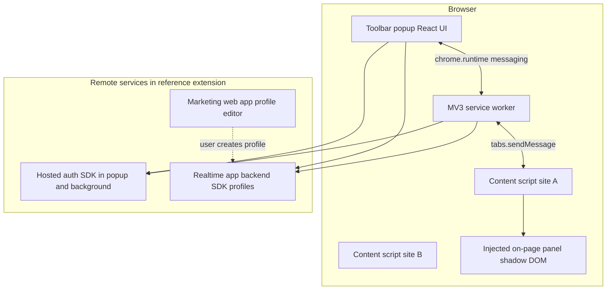

# Directory-launch extension UI patterns (spike notes)

Neutral observations from unpacking a **Manifest V3** Chrome extension (store version **1.4.6**, ~3.4 MiB) that automates **human-in-the-loop** directory submissions. These notes inform OpenQuok **auto-launch v1** (popup, per-site content scripts, optional step rail). **No third-party source code** is copied into this repository; spike artifacts stay outside git (local unpack only).

---

## Scope and methodology

| Item | Detail |
| --- | --- |
| Artifact | CRX v3 unpacked to a local scratch directory (ZIP payload after CRX header) |
| Build toolchain | Plasmo-style MV3 layout: hashed bundles, `popup.html` mounting a single React root, Parcel-style module graph in bundles |
| What we inspected | `manifest.json`, popup entry, background service worker, one **multi-step** directory bundle, manifest `content_scripts` list |
| What we did not ship | Minified JS, selectors, DOM queries, or proprietary filler implementations |

Use this document to shape `auto_launch_destinations.extension_config`, extension messaging in `common/src/browser-extension/`, and OpenQuok’s popup + on-page panel—not to mirror another product’s codebase.

---

## Layered architecture

**OpenQuok v1 mapping (contrast):**

| Reference pattern | OpenQuok v1 |
| --- | --- |
| Third-party auth + BaaS profile sync | OpenQuok session cookies on `openquok.com`; `GET/POST /api/v1/auto-launch/*` org-scoped |
| Web app as profile source of truth | Dashboard **My Products** + `submissions/intent` returns `profile_snapshot` + `extension_config` |
| No `externally_connectable` in reference manifest | Dashboard handoff via existing `externally_connectable` + `extensionClient` (Skool path) |

---

## Toolbar popup

### Structure

- `action.default_popup` → minimal HTML shell + one client bundle (React).
- Primary jobs: **sign-in gate**, **SaaS profile picker**, **contextual status** for the active tab, **launch / autofill actions**, footer **disclaimer**.

### Auth and empty states (observed copy themes)

| State | User-facing intent |
| --- | --- |
| Signed out | Prompt to sign in to manage directory submissions and load saved profiles |
| Signed in, no profiles | “Create your first … profile to get started” (links user to web app) |
| Signed in, profiles loaded | Searchable list; “Untitled Profile” fallback label |

### Profile selection

- Dropdown or list bound to remote profile documents (name, tagline, website).
- Selection drives all fill operations on the active tab.

### Status line (contextual)

The popup and/or on-page UI reflect **page URL and directory adapter**, not a single static string. Examples of **status categories** extracted from the multi-step directory bundle:

| Situation | Example status text (paraphrased themes) |
| --- | --- |
| Wrong page | “Not on a … submission page” / “Not on a supported page” |
| Pre-submit URL step | “Step 1: Paste your product URL”, “Ready to autofill product URL” |
| Awaiting user navigation | “Navigate to ‘Submit’ to start auto-filling” |
| In progress | “Filling…”, “Step *k*/*n*: Filling …”, “Ready to fill: …” |
| Success (partial or full) | “Fields filled successfully”, “All fields filled! Please review before submitting” |
| Failure | “Autofill failed - check console”, “No fields could be filled”, “Some fields could not be filled - check field statuses” |

### Primary actions

| Control | Behavior |
| --- | --- |
| **Fill / autofill all steps** | Sequentially runs step fillers on the submission flow; may **click “Next”** between wizard steps (still no final Publish/Submit automation emphasized in disclaimer) |
| Per-step **Fill** | Available in the on-page rail (see below); popup may mirror “click to autofill each step” |
| **Reset panel position** | UX affordance to re-anchor the floating panel (reference uses expandable overlay chrome) |
| Login CTA | “Go to Login” when session missing |

### Disclaimer (footer)

- Privacy-oriented line: actions run **locally in the browser**; user reviews and submits on the directory site (ToS / human-in-the-loop positioning).

**OpenQuok:** Reuse tone from `BrowserExtensionConnectDialog` / channel connect legal pattern where applicable; keep disclaimer in popup footer.

---

## Background service worker

- Single large bundle: auth client, profile/API client, and UI kit remnants (same stack as popup).
- Responsibilities inferred from MV3 layout and cross-bundle strings:
  - Message hub between popup and content scripts
  - Profile fetch / cache coordination
  - Optional analytics or logging hooks (failed message / connection loss handling)
- **Permissions:** `storage`, `cookies`; **host_permissions** per directory origin plus auth/API hosts.

**OpenQuok:** Extend `extension/background.js` with `AUTO_LAUNCH_*` routes; complete submissions via cookie-authenticated `POST …/submissions/complete` (extension-only).

---

## Per-site content script bundles

MV3 requires **static** `content_scripts` entries—no dynamic registration. The reference extension ships **one JS bundle per directory**, registered only on that site’s URL patterns.

### Manifest pattern

| Field | Typical use |
| --- | --- |
| `matches` | Mix of site root, `/submit`, `/posts/new`, or form-specific paths |
| `js` | Single hashed bundle per provider |
| `run_at` | `document_idle` |

### Seeded destinations in v1.4.6 spike (18 bundles)

Count and **host patterns** matter for OpenQuok’s `directoryLaunchProviders` registry (`hostPatterns`, `contentScriptEntry`). Observed registrations:

| Bundle key (filename stem) | URL focus (summary) |
| --- | --- |
| `producthunt` | `producthunt.com` including `/posts/new` |
| `betalist` | `betalist.com/submissions/…` |
| `devto` | `dev.to` |
| `alternativeto` | `alternativeto.net/manage-item/…` |
| `launchingnext` | `launchingnext.com/submit/…` |
| `sideprojectors` | `…/submit/project/…` |
| `tinylaunch`, `firsto`, `launchigniter`, `peerpush`, `huzzler`, `promoteproject`, `startupslab`, `saashub`, `crunchbase`, `brownbook`, `sitelike` | Marketing or submit paths on each matching host |
| `microlaunch` | Specific third-party form URL (`tally.so/…`) |

Simpler sites: one-shot form fill inside the bundle, often **without** a step rail. Complex sites: dedicated adapter + injected UI.

**OpenQuok v1:** Start with **2–3** destinations (e.g. Uneed-first); add manifest entries per `provider_slug`; keep filler logic in `extension/content/directory-launch/{slug}.js` keyed to `extension_config`.

---

## Multi-step flow: Product Hunt–style step rail

The richest UX in the spike is a **left (or overlay) “Submission steps” rail** on the multi-step directory wizard (`/posts/new/submission` path theme). OpenQuok should drive equivalent UI from `auto_launch_destinations.extension_config.steps[]` (labels, field keys, selector hints)—not hard-coded competitor strings in source.

### Step catalog (IDs and labels)

| Step `id` | Label shown in rail |
| --- | --- |
| `main-info` | Main Info |
| `images-and-media` | Images & Media |
| `makers` | Makers |
| `shoutouts` | Shoutouts |
| `extras` | Extras |
| `launch-checklist` | Launch Checklist |

Rail section title: **Submission Steps**.

### Step card UX

Each step row includes:

| Element | Purpose |
| --- | --- |
| Step icon | Completed vs current vs pending |
| Label | From table above |
| Progress | `filledCount / totalFields` style bar when current |
| **Fill** button | Runs one step’s filler module |
| Field checklist | Per-field row: label, filled / empty / error icon |

### Field-level status vocabulary

| Status | Meaning |
| --- | --- |
| Filled | DOM target found and value applied |
| **Field not found** | Selector missed (site DOM drift) |
| **Not in profile** | Profile snapshot missing mapped value |
| Site-specific | e.g. “Fields not found - PH may have changed” (directory may have updated UI) |

Aggregated toasts: “*n* fields filled, *m* issue(s)”, “Failed to fill *step*”.

### Automation sequence (“fill all”)

Observed orchestration (behavioral summary only):

1. Detect **active wizard step** (data attributes on step container, e.g. `data-test` / `data-status`).
2. Map step id → filler module (`mainInfo`, `images`, `makers`, `shoutouts`, `extras`, `launchChecklist`).
3. Run filler; update field statuses.
4. If configured, **click Next** and wait until the next step becomes active; repeat until last step or error.
5. **Does not** auto-click final directory **Publish/Submit** (aligned with disclaimer).

Pre-wizard **URL paste** step is separate: copy themes include product URL field, “URL filled - click Continue”, login checks for the directory account.

### Representative field labels (for `extension_config` seeding)

These are **directory form labels** the reference maps to profile paths—not OpenQuok UI copy:

- Main Info: product name, tagline, description, pricing type, category/tags, website/product URL
- Images & Media: logo, gallery/screenshots, banner; handles upload inputs and clearing existing media
- Makers: maker usernames tied to directory accounts
- Shoutouts: shoutout entries
- Extras: first comment, “why did you build this”, launch tags, video/loom link
- Launch Checklist: checklist-specific controls

Use these as hints when authoring `profilePath` and `selectorHint` in seeds; validate against live DOM during implementation.

---

## Adapter abstraction (conceptual)

The multi-step bundle implements a **directory adapter** pattern:

| Concept | Role |
| --- | --- |
| `detectCurrentStep()` | Returns active step id or null |
| `getStatusMessage(step, context)` | Popup/rail status strings |
| Step fillers | Async functions: `{ profile, setFieldStatuses }` → per-field results |
| Shared DOM helpers | Label-based setters, image upload helpers, URL input helper |

OpenQuok equivalent: `fillStep(stepId, profileSnapshot)` per `provider_slug` module; config defines steps/fields; progress events via `AUTO_LAUNCH_PROGRESS`.

---

## Error handling and DOM drift

| Scenario | UX |
| --- | --- |
| Selector miss | Field row error; console diagnostics with tagged log prefix |
| Step not implemented | “Step not implemented yet” / “Step not supported” |
| Wizard navigation failure | Messages when Next click fails or next step never activates |
| Partial fill | User asked to review before submit; aggregate issue count |

Recommend **`extension_config.version`** in OpenQuok seeds and hub copy that directories change frequently.

---

## Mapping checklist → OpenQuok implementation

| Spike pattern | OpenQuok artifact |
| --- | --- |
| Popup profile picker + status | `extension/popup/` + cached API profiles |
| Per-site bundle | `manifest.json` `content_scripts` + `directory-launch/{slug}.js` |
| Step rail + per-step Fill | Content script panel; `extension_config.steps` from API via `intent` |
| Fill all | `AUTO_LAUNCH_FILL_ALL` message; sequential `fillStep` |
| Dashboard handoff | `web/src/lib/auto-launch/browser-extension/` + `AUTO_LAUNCH_HANDOFF` |
| Human submit | No auto-submit; `submissions/complete` with evidence URL only after user confirms |

---

## Seeded v1 destinations: dashboard → extension mapping

OpenQuok stores business profiles in `auto_launch_product_profiles` (top-level `name`, `tagline`, `description`, `website_url`, `logo_url`, plus JSON `profile_data`). The extension receives a **profile snapshot** and **`extension_config.steps[]`** from the launch handoff (`submissions/intent`). Each step field’s `profilePath` is resolved against that snapshot; `fillMode` drives how values are written into the directory DOM (`text`, `rich_html`, `tags`, `select`, `boolean`, file upload for logo/gallery).

**Authoritative seeds** (update these tables when `extension_config` changes):

| Provider slug | Destination name | Start URL | Seed file |
| --- | --- | --- | --- |
| `uneed-join-line` | Uneed — Join the line | `https://uneed.best/pricing` | `backend/supabase/db/auto-launch/502_20261013_seed_uneed_destinations.sql` |
| `peerpush-free-queue` | PeerPush — Free queue | `https://peerpush.com/pricing` | `backend/supabase/db/auto-launch/503_20261016_seed_peerpush_destination.sql` |
| `peerpush-standard-launch` | PeerPush — Standard launch | `https://peerpush.com/submit` | `backend/supabase/db/auto-launch/503_20261016_seed_peerpush_destination.sql` |

`uneed-paid-launch` reuses the same product-listing steps as Join the line. `uneed-maker-profile` is a smaller profile-only flow (not used in the default smoke test below). `peerpush-free-queue` reuses the Standard launch `extension_config` with `readyUrlHint: pricing`.

**Link directory dofollow (catalog):** PeerPush Standard launch is `dofollow` (paid instant listing). PeerPush free queue is `unknown` (same pattern as Uneed Join the line — pricing does not document nofollow for the free tier; verify `rel` on the live listing).

### Dashboard composer tabs (My Products → Edit profile)

| Composer tab | Profile paths used by directory seeds |
| --- | --- |
| **General** | `name`, `tagline`, `description`, `website_url`, `profile_data.slug`, `profile_data.pricing_type`, `profile_data.tags`, `profile_data.is_open_source`, `profile_data.repository_url` |
| **Discovery** | `profile_data.categories` (first entry is persisted as `profile_data.category` for Uneed), `profile_data.use_cases`, `profile_data.target_audiences`, `profile_data.platforms`, `profile_data.alternatives` (max counts in `common/src/auto-launch/businessProfileData.ts`) |
| **Media** | `logo_url`, `profile_data.launch_video_url`, `profile_data.gallery_urls` |
| **Socials** | `profile_data.social_*` (X, GitHub, Instagram, LinkedIn, TikTok, Facebook, YouTube, Bluesky) |
| **Sell** | Acquisition and revenue fields; **PeerPush optional MRR** maps to `profile_data.monthly_revenue_usd` (label: “Monthly recurring revenue (optional)”) |

Readiness on product cards uses the same `profilePath` list as each destination’s `extension_config` (`getProfileLaunchSummary` / `getDestinationReadiness` in `common/src/auto-launch/profileLaunchReadiness.ts`). The hint line opens **Discovery** when missing paths are discovery-only; otherwise **General**.

### Uneed — Join the line (`uneed-join-line`)

| Extension step | Directory form label | `profilePath` | `fillMode` | Composer tab |
| --- | --- | --- | --- | --- |
| General | Product name | `name` | text | General |
| General | Slug | `profile_data.slug` | text | General |
| General | Website | `website_url` | text | General |
| General | Tagline | `tagline` | text | General |
| General | Category | `profile_data.category` | select | Discovery (saved as first `categories` entry) |
| General | Pricing | `profile_data.pricing_type` | select | General |
| General | Tags | `profile_data.tags` | tags | General |
| General | Open source | `profile_data.is_open_source` | boolean | General |
| General | Repository URL | `profile_data.repository_url` | text | General |
| General | Rich description | `description` | rich_html | General |
| Media | Logo | `logo_url` | file | Media |
| Media | Launch video URL | `profile_data.launch_video_url` | text | Media |
| Media | Gallery images | `profile_data.gallery_urls` | file | Media |
| Socials | X (Twitter) … Bluesky | `profile_data.social_*` | text | Socials |
| Sell | Listed for acquisition … Included assets | `profile_data.acquisition_*`, prices, `selling_reason`, `included_assets` | boolean / text / tags | Sell |

After handoff, open Uneed from **Pricing**, start the Join the line / product listing flow, and use the extension step rail (**Fill** per step or fill-all). Proof hints: listing URL patterns in seed `proof.successPathRegex` / `listingUrlSelector`.

### PeerPush — Free queue (`peerpush-free-queue`)

Same step/field mapping as Standard launch (`extension_config` is shared; handoff opens **pricing** first). After you choose **Submit for Free** and reach `peerpush.com/submit`, use the extension step rail the same way as Standard launch.

### PeerPush — Standard launch (`peerpush-standard-launch`)

| Extension step | Directory form label | `profilePath` | `fillMode` | Composer tab |
| --- | --- | --- | --- | --- |
| Basic | Product name | `name` | text | General |
| Basic | Tagline | `tagline` | text | General |
| Basic | Description | `description` | rich_html | General |
| Basic | Website | `website_url` | text | General |
| Basic | Logo | `logo_url` | file | Media |
| Discovery | Categories | `profile_data.categories` | tags | Discovery |
| Discovery | Use cases | `profile_data.use_cases` | tags | Discovery |
| Discovery | Target audience | `profile_data.target_audiences` | tags | Discovery |
| Discovery | Pricing | `profile_data.pricing_type` | select | General |
| Discovery | Platforms | `profile_data.platforms` | tags | Discovery |
| Discovery | Similar products | `profile_data.alternatives` | tags | Discovery |
| Discovery | Monthly recurring revenue (optional) | `profile_data.monthly_revenue_usd` | text | Sell |
| Media | Screenshots | `profile_data.gallery_urls` | file | Media |

Tag-style fields use `fillMode: "tags"` in the seed; the extension formats array values for PeerPush combobox/tag inputs (`extension/src/directory-launch/profileValues.ts`). Logo and gallery steps use file inputs (fetch from stored logo/gallery URLs).

---

## Manual smoke test: My Products cards (Uneed + PeerPush)

Use this checklist after local migrations and a fresh extension build. Goal: one business profile, multiple **published** launch variants (Uneed + PeerPush seeds), card aggregate **`0/2` → `1/2` → `2/2` directories submitted** (one count per directory **site**, not per launch variant), plus readiness and stale badges.

### Prerequisites

1. **Database**: Aggregated migrations applied so `uneed-join-line`, `peerpush-free-queue`, and `peerpush-standard-launch` exist with `is_published = true` (seeds above).
2. **Web + API**: Dashboard signed into a workspace with auto-launch routes enabled.
3. **Extension**: From monorepo root, `pnpm common:build` and `pnpm --filter @openquok/browser-extension build`; load **`extension/dist`** in Chrome and reload after each build (`extension/README.md`).
4. **Handoff**: `VITE_OPENQUOK_BROWSER_EXTENSION_ID` matches the loaded extension; stay on the same origin as `externally_connectable` (localhost or `openquok.com`).

### A. Product card — empty / partial profile

1. Open **Account → My Products** (`/account?tab=products`).
2. **Create product** (or use an existing test profile). Save only **General** basics (name + website) — leave logo and Discovery empty.
3. Confirm **business profile card** UI:
   - **Draft** badge (no logo or no completed submission yet).
   - Aggregate line: **`0/N directories submitted`** where `N` is the count of unique directory **sites** with at least one published destination (expect **2**: Uneed and PeerPush, even when three or more launch rows appear under **Directory launches**).
   - Readiness hint when fields are missing, e.g. **“Fill *k* more fields to autofill on …”** — click it; composer opens on **Discovery** or **General** per missing paths.
4. On the card, confirm **Directory channels** shows the SVAR table (same **Add filters** smart-filter pattern as Account → Channels table view):
   - One row per directory **site** (Uneed, PeerPush). **Launch** opens that site’s launch paths (join line, paid slot, standard submit, and so on).
   - Readiness badge: **Ready** or **N fields missing**.
   - **Launch** visible when no `completed` submission for that destination.

### B. Fill profile for both directories

1. **Edit profile** → complete fields that both seeds require at minimum: logo (**Media**), description and pricing/tags (**General**), **Discovery** categories and other tag fields for PeerPush and Uneed as needed.
2. Save; card should show higher fill readiness on both rows (ideally **Ready** on each).
3. Optional: deep-link edit tab — `/account?tab=products&edit=<profileId>&tab=discovery`.

### C. Launch Uneed (first submission)

1. On the card, **Directory launches → Uneed — Join the line → Launch** (or **Add directory launch** with site picker).
2. Complete extension connect if prompted; confirm handoff opens `https://uneed.best/pricing` (or the listing wizard Uneed shows after pricing).
3. In the extension UI, run autofill per step; **submit on Uneed manually** (human-in-the-loop).
4. Mark submission **complete** in the extension flow (evidence URL / complete API).
5. Refresh or revisit **My Products**:
   - Aggregate **`1/2 directories submitted`**.
   - Uneed row: **Synced** (or sync pending briefly); **Launch** hidden when `completed`.
   - **Live** badge appears when logo + website + ≥1 completed submission.

### D. Launch PeerPush (second submission)

1. **Directory launches → PeerPush — Standard launch → Launch**.
2. Handoff should land on `https://peerpush.com/submit`.
3. Autofill **Basic**, **Discovery**, **Media** steps; verify tag and rich description fields in the extension field checklist.
4. Complete listing on PeerPush manually; mark **complete** in the extension.
5. After both **sites** have at least one completed submission, card shows **`2/2 directories submitted`**; completed rows show synced state (you may still have other launch variants incomplete).

### E. Stale / Re-fill

1. **Edit profile** and change a mapped field (e.g. tagline or a Discovery category).
2. Save; expand **Directory launches**:
   - Completed rows should show **Profile changed** (stale sync) and **Re-fill**.
3. **Re-fill** one destination; confirm extension runs with updated snapshot; complete again if you change live listings.

### F. Failure signals (quick triage)

| Symptom | Likely cause |
| --- | --- |
| Handoff never reaches extension | Wrong extension ID, origin not in `externally_connectable`, or extension not loaded |
| **Field not found** in step rail | Directory DOM drift vs `selectorHint` in seed — update `extension_config` / content script |
| **Not in profile** | Missing `profilePath` on snapshot — fill composer tab from mapping tables above |
| Card stays `0/2` after fill | No `status === 'completed'` submission yet for any destination on a site, or destinations not `is_published` |
| Readiness hint opens wrong tab | Missing path is discovery-prefixed vs general-only (`buildProfileLaunchCardVm.ts`) |

---

## Related docs

- Auto-launch architecture (protocol, tables, modal flow): `docs/auto-launch/architecture.md` (when added)
- Future launch showcase (entries, boost stub, SKU): `docs/auto-launch/launch-showcase.md`
- Internal implementation plan: auto-launch v1 modal + extension milestones in product planning (not duplicated here)

---

## Revision log

| Date | Notes |
| --- | --- |
| 2026-10-16 | Uneed + PeerPush `profilePath` mapping tables; My Products card manual smoke test |
| 2026-10-13 | Initial spike from CRX v1.4.6 unpack; PH-style step ids/labels and per-site manifest inventory |
