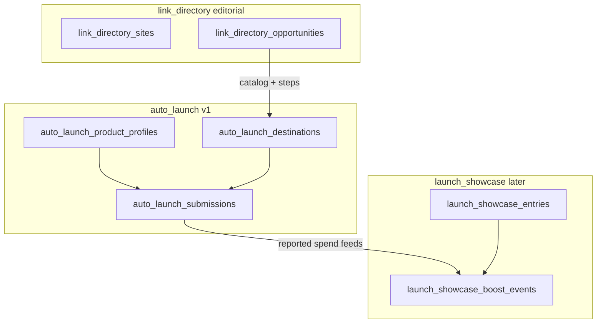

# Launch showcase (future domain)

Launch showcase is a **post–auto-launch** product surface: public discovery of shipped products, optional paid **boost** placement, and accounting that can incorporate **reported directory spend** from completed auto-launch submissions. It is **not** part of auto-launch v1 execution (extension handoff, profiles, destinations, submissions). v1 only reserves schema and documents the intended split so auto-launch and editorial link-directory work can land without redesign.

---

## How it relates to other domains

| Domain | Table prefix | v1 scope |
| --- | --- | --- |
| Build backlinks (editorial) | `link_directory_*` | Guides and CTAs into the directory-launch modal |
| Auto-launch (execution) | `auto_launch_*` | Profiles, destinations, extension submissions |
| Launch showcase (discovery) | `launch_showcase_*` | **Stubs + documentation only** |

Auto-launch answers: *“Help me fill and track a launch on Uneed, Product Hunt, etc.”*  
Launch showcase answers: *“Show my launch on OpenQuok and optionally boost visibility.”*

---

## Planned tables

### `launch_showcase_entries` (not migrated in v1)

One row per **public showcase listing** for a product launch (distinct from an `auto_launch_submission` attempt on a third-party directory).

Intended responsibilities (subject to change before build):

| Concern | Direction |
| --- | --- |
| Ownership | Workspace (`organization_id`); ties to a product profile and/or completed submission |
| Visibility | Draft vs published; slug or canonical URL for public routes |
| Content | Title, tagline, media, links — may mirror or snapshot `auto_launch_product_profiles` |
| Entitlement | Gated by billing (see **Standard Launch** SKU below) |

No `CREATE TABLE` for entries ships in v1 so auto-launch migrations stay the only executable launch path in production.

### `launch_showcase_boost_events` (v1 stub)

A **placeholder** table exists so later migrations can attach foreign keys and reporting without reordering the auto-launch module. The stub carries identifiers and timestamps only; event types, amounts, and joins to entries/submissions are added when showcase work starts.

Location: `backend/supabase/db/launch-showcase/101_20261013_tables.sql`

---

## Planned product and API surfaces (v1: none)

These are documented for alignment across billing, web, and public API work later—not implemented in auto-launch v1.

### Entitlements

Workspace-level flags or subscription items that allow:

- Creating or publishing a showcase entry
- Purchasing or applying **boost** credits / campaigns

Implementation will likely follow existing billing patterns under `backend/supabase/db/billing/` and organization-scoped checks in route middleware (same style as other paid capabilities).

### Standard Launch SKU

A commercial **Standard Launch** (or similarly named) offering that bundles showcase placement and/or boost allowance. Exact price IDs and Stripe/RevenueCat mapping live in subscription config when the SKU ships; no SKU is wired in v1.

### Public routes

Expected shape (illustrative, not routed today):

- Public gallery or entry detail pages on the marketing site or app shell
- Optional authenticated APIs under a future `/api/v1/launch-showcase/*` public or session surface

Public API surface-sync rules apply when those routes are added.

---

## Data flow: submissions → boost (future)

When a user completes a directory launch via the extension, `auto_launch_submissions` stores `evidence` and optional `listing_url`. Showcase boost accounting may **ingest reported spend or boost purchases** as `launch_showcase_boost_events` rows linked to:

- A showcase **entry** (campaign owner), and/or
- An **auto_launch_submission** (attribution for “we launched on X and spent Y”)

Exact fields (currency, directory slug, receipt refs) will be defined in the showcase milestone; the v1 stub does not enforce that shape.

---

## Implementation checklist (when showcase work starts)

1. Expand `launch_showcase_boost_events` (types, amounts, FKs to entries and submissions).
2. Add `launch_showcase_entries` migration tier (`101_*_tables`), indexes, RLS, and grants.
3. Billing entitlements + Standard Launch SKU.
4. Web UI (gallery, entry editor, boost purchase).
5. Public routes and OpenAPI/SDK if exposed to API-key or anonymous clients.

Until then, refer to auto-launch architecture and extension docs for everything users can do in v1:

- `docs/auto-launch/extension-ui-patterns.md`
- `extension/README.md` (directory launch handoff)
